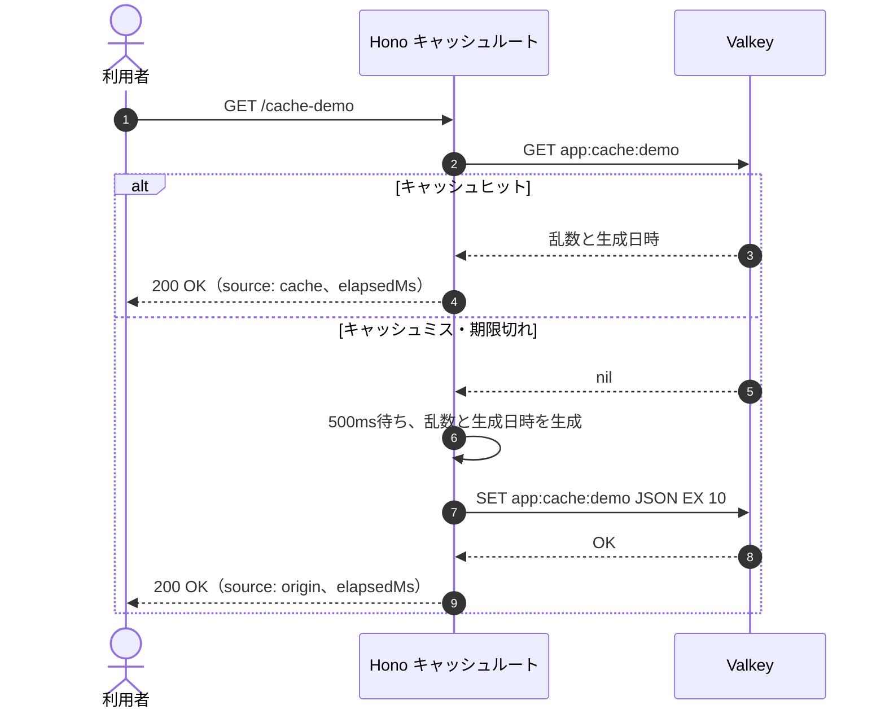
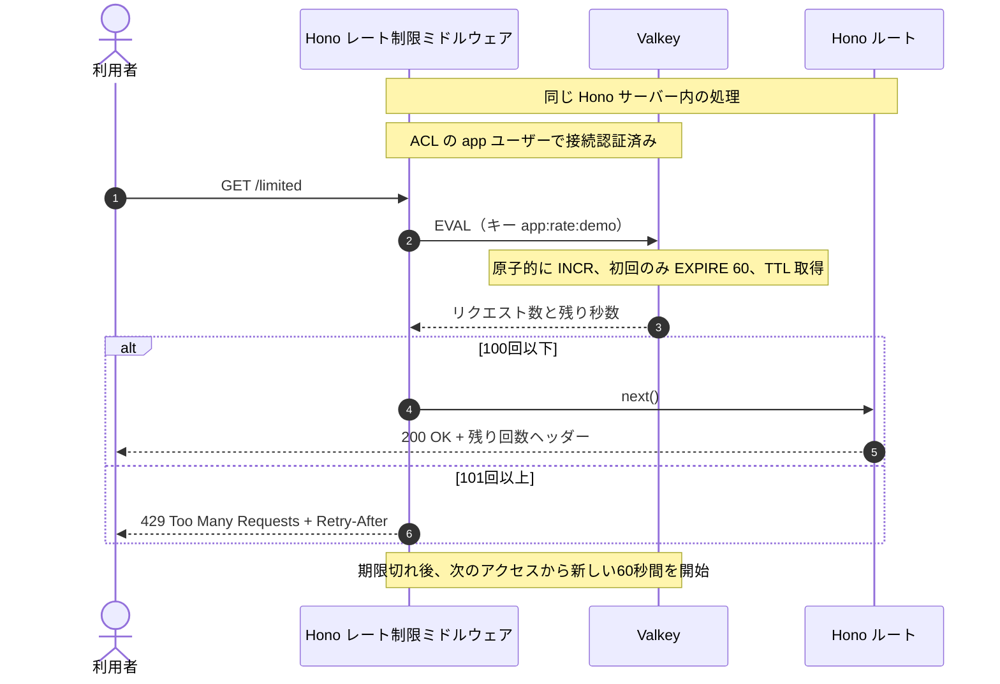
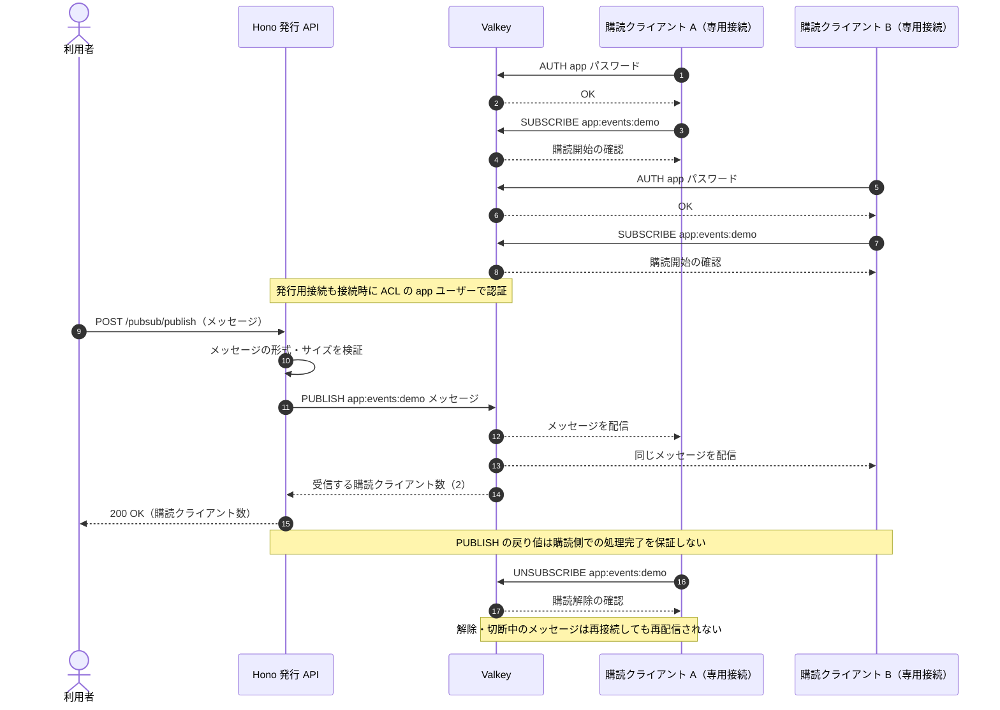

# Valkey 入門


## 起動

```sh
docker compose up -d --wait
docker compose exec valkey valkey-cli --user app --askpass ping
# PONG
```


## 認証・認可

`compose.yaml` で `users.acl` を読み込み、ACL でユーザーごとの権限を設定します。
`user default off` でデフォルトユーザーによる新規認証を無効

| ユーザー | 学習用パスワード | 権限 |
| --- | --- | --- |
| `app` | `local-app-password` | `app:*` のキーに対する下記の練習用コマンドと `PING` |
| `admin` | `local-admin-password` | 全操作 |
| `health` | `local-health-password` | ヘルスチェック用の `PING` のみ |

### 管理用CLI入り方
パスワードは `local-admin-password` です。

```sh
docker compose exec valkey valkey-cli --user admin --askpass
```

ACL ファイルを変更した後は `docker compose restart valkey` で反映します。
ACL ファイルは読み取り専用でマウントしているため、`ACL SAVE` では保存できません。

monitorコマンドで内部のログなどを確認できる

## デモのシーケンス

### 1. キャッシュ

`GET /cache-demo` は取得元で生成した乱数と日時を10秒間キャッシュします。
取得元は DB の代わりに500ms待つ処理で再現しています。

Valkey を起動後、別のターミナルで Hono を起動してください。

```sh
cd app
pnpm install
pnpm dev
```

以下を繰り返すと、初回は `source: "origin"`、10秒以内は `source: "cache"` と同じ乱数・生成日時が返ります。
期限切れ後は再生成されます。`elapsedMs` はサーバー内の処理時間です。

```sh
curl http://localhost:3000/cache-demo
```

接続設定は `VALKEY_HOST`・`VALKEY_PORT`・`VALKEY_USERNAME`・`VALKEY_PASSWORD` で変更できます。
既定値は `127.0.0.1:6379`、`app`、`local-app-password` です。
Valkey 接続失敗時は Hono の起動に失敗し、起動後の読み書き失敗時は `503` を返します。
このデモは同時キャッシュミスをまとめないため、期限切れ直後の大量アクセスでは取得元の処理が重複します。



### 2. レートリミット

`GET /limited` は最初のアクセスから60秒間で100回まで許可します。
利用者認証は未実装で、全アクセスが固定キー `app:rate:demo` を共有するデモです。
利用者別にする場合は、検証済みの利用者 ID からキーを作成します。

Lua スクリプトでカウント加算と初回の期限設定を原子的に実行します。
制限後のアクセスで期限は延長しません。Valkey 処理失敗時は `503` を返します。



```sh
for i in $(seq 1 101); do
  curl -s -o /dev/null -w '%{http_code}\n' http://localhost:3000/limited
done
```

### 3. Pub/Sub

`GET /pubsub/events` は Valkey の通知を SSE で配信します。
HTTP 接続ごとに専用の Valkey 購読接続を作り、切断時に解放します。
接続中は15秒ごとにコメントを送って接続を維持します。
配信待ちが詰まった受信側や Valkey 接続エラー時は SSE を閉じます。
購読開始に失敗した場合は `503` を返します。

受信は下記のどちらか

```sh
curl -N http://localhost:3000/pubsub/events
```

```sh
docker compose exec valkey valkey-cli --user app --askpass SUBSCRIBE app:events:demo
```

送信

```sh
curl -X POST http://localhost:3000/pubsub/publish \
  -H 'Content-Type: application/json' \
  -d '{"message":"こんにちは"}'
# {"channel":"app:events:demo","subscribers":1}
```


